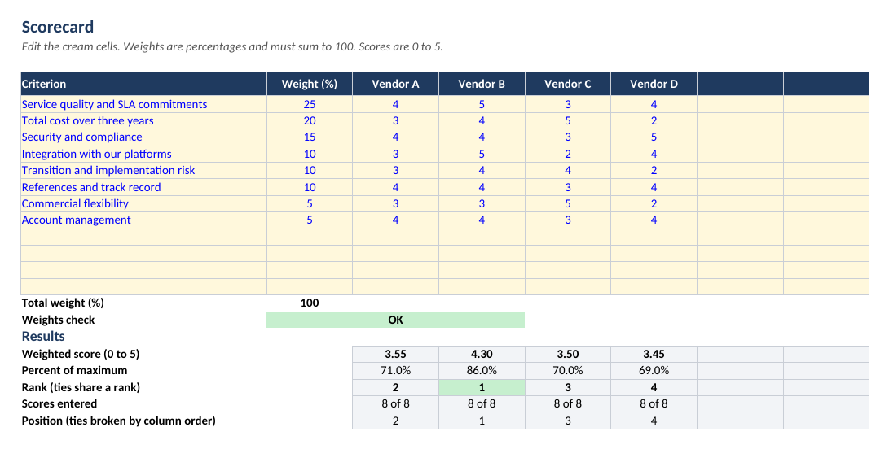
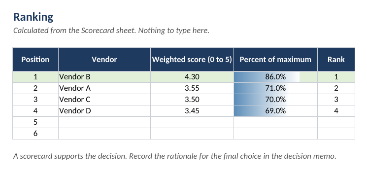

# Vendor scorecard

A weighted-criteria model for comparing shortlisted suppliers fairly and showing the working. The example scores four fictional vendors for a managed service desk re-tender at Northwind Freight (fictional).

| File | Purpose |
|---|---|
| [vendor-scorecard.xlsx](vendor-scorecard.xlsx) | The model. Live formulas for the weights check, weighted score and ranking. |
| [vendor-scorecard-example.csv](vendor-scorecard-example.csv) | The same inputs as plain data |
| [score_vendors.py](score_vendors.py) | A short Python script that computes the same ranking from the CSV, so the workbook can be cross-checked |





## How the model works

```
weighted score = SUMPRODUCT(weights, scores) / SUM(weights)      (on a 0 to 5 scale)
percent of maximum = weighted score / 5
rank = 1 + number of vendors with a higher weighted score         (ties share a rank)
```

- Weights are percentages and must sum to 100. The workbook shows a weights check, and the weighted score displays "Check weights" until it passes.
- Scores run from 0 to 5. Data validation rejects values outside that range.
- Up to 12 criteria and 6 vendors are supported. Leave unused cells blank.
- The Ranking sheet orders vendors by score. If two vendors tie, they share a rank and appear in column order.

## Using it

1. Agree the criteria and weights with the stakeholders **before** reading any proposals, and record who agreed them.
2. Decide which requirements are mandatory pass or fail gates. A vendor that fails a gate is excluded, however well it scores elsewhere.
3. Score independently first (each panel member alone), then agree a moderated score for each cell and write down the evidence.
4. Score cost by a rule agreed in advance. The Guide sheet gives one example.
5. Read the ranking. If the top two are close, run a clarification round or reference calls rather than treating the gap as decisive.
6. Test sensitivity. Change the weights by a few points and check whether the winner changes. If it does, say so in the decision memo.
7. Record the outcome in the [technology decision memo](../07-technology-decision-memo/template.md).

## Cross-checking the workbook against the script

```bash
python 04-vendor-scorecard/score_vendors.py 04-vendor-scorecard/vendor-scorecard-example.csv
```

Output for the example data:

```
Rank  Vendor              Weighted score (0-5)    % of max
1     Vendor B            4.300                   86.0%
2     Vendor A            3.550                   71.0%
3     Vendor C            3.500                   70.0%
4     Vendor D            3.450                   69.0%
```

The automated tests in `tests/` recalculate the workbook in LibreOffice and compare its results with the script, and check that the CSV and the workbook inputs are identical.

To regenerate the workbook and CSV from the example data, run `python tools/build_all.py`.

## Limits

A scorecard makes judgement visible. It does not remove judgement. It does not replace reference checks, security review, financial due diligence or legal review of the contract.
