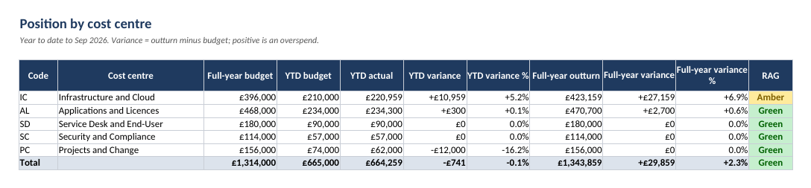
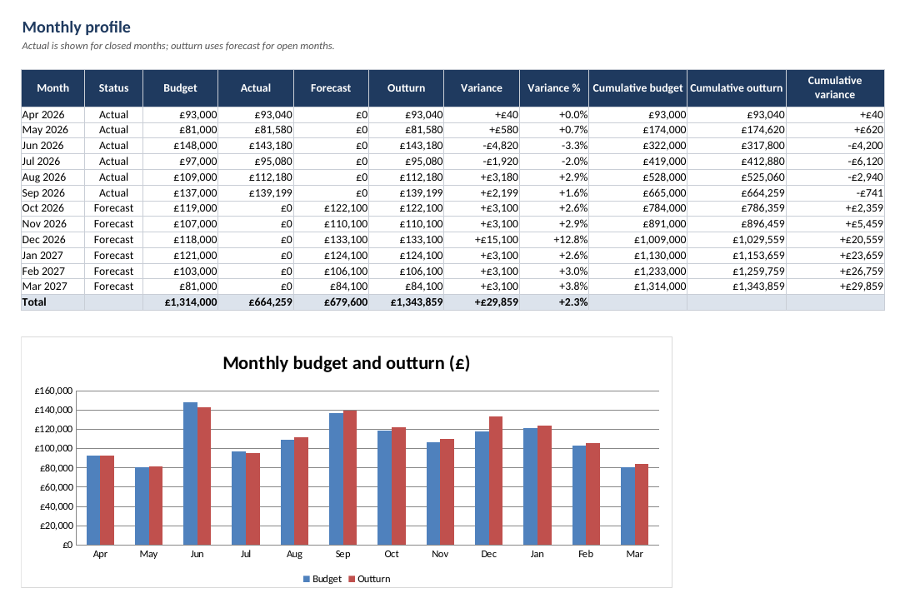
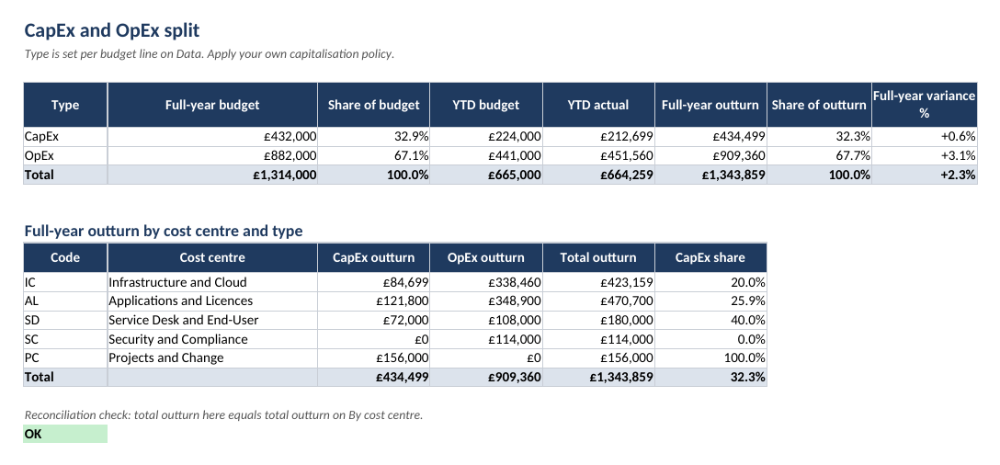

# IT budget tracker

An Excel workbook that tracks budget, actual spend and forecast by cost centre, budget line and month, with a CapEx and OpEx split. The example uses invented figures for Northwind Freight (fictional), financial year 2026/27, reported at September 2026.

File: [it-budget-tracker.xlsx](it-budget-tracker.xlsx)

## Sheets

| Sheet | What it shows | Typed or calculated |
|---|---|---|
| Guide | Purpose, monthly routine, conventions | Text |
| Settings | Reporting month, amber and red thresholds, cost centres | Inputs |
| By cost centre | Full-year budget, year-to-date budget and actual, outturn, variance and RAG | Calculated |
| By line | The same by budget line | Calculated |
| Monthly | Budget, actual, forecast, outturn and cumulative variance by month, with a chart | Calculated |
| CapEx vs OpEx | Split by type and by cost centre, with a reconciliation check | Calculated |
| Data | One row per budget line per month: budget, actual, forecast | Inputs, with three formula columns |

## Starting your own

The workbook is both the model and the worked example. To use it for your own budget, keep the formulas, delete the example rows in `Data` (columns A to H only, leaving the formula columns I to K in place), enter your own lines and cost centres, and update `Settings`. Fill the Line ID list on `By line` to match your own line IDs.

## Definitions

- **Outturn** is the latest view of the full year: actual for closed months, forecast for open months. In `Data`, `Outturn = IF(ISNUMBER(Actual), Actual, Forecast)`.
- **Variance** is outturn (or actual) minus budget. Positive means overspend.
- **RAG**: Green at or below the amber threshold, Amber above it, Red above the red threshold. The thresholds on `Settings` (5 percent and 10 percent) are examples. Set your own.
- **YTD** uses every month up to and including the reporting month on `Settings`.
- All summary sheets use `SUMIFS` over `Data`, so adding rows to `Data` flows through without editing formulas. The summaries read to row 1000.

## Monthly routine

1. Type the closed month's actuals into the Actual column on `Data` and reconcile the total to the finance ledger.
2. Update the Forecast column for open months where you know something has changed.
3. Move the Reporting month on `Settings` forward by one.
4. Check the reconciliation cell on `CapEx vs OpEx` reads OK.
5. Take the figures for the board report from `By cost centre`.

## Reading the example

Cloud hosting (line IC01) is running above budget and is forecast to finish roughly 12 percent over, which turns Infrastructure and Cloud Amber. Warehouse scanning (PC01) is behind plan year to date because of a late delivery, with spend forecast to catch up by December. The total is within the example thresholds. These are the same figures used in the [board report example](../02-board-it-report/example-northwind-board-report.md).

## Verification

The workbook was recalculated with LibreOffice headless. All formulas computed without error values, and the totals matched an independent calculation in Python (`tests/test_budget_tracker.py`). The `.xlsx` in this repository stores the calculated values, so it previews correctly in tools that do not calculate. Excel will recalculate on opening.

## Limits

This is a management tracker, not an accounting system. Apply your own capitalisation policy when tagging CapEx and OpEx, and reconcile to finance each month. To regenerate the workbook, run `python tools/build_all.py`.
