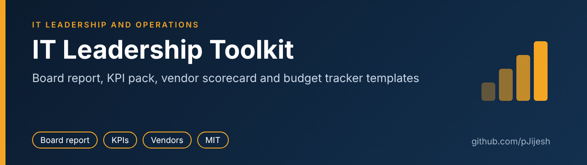
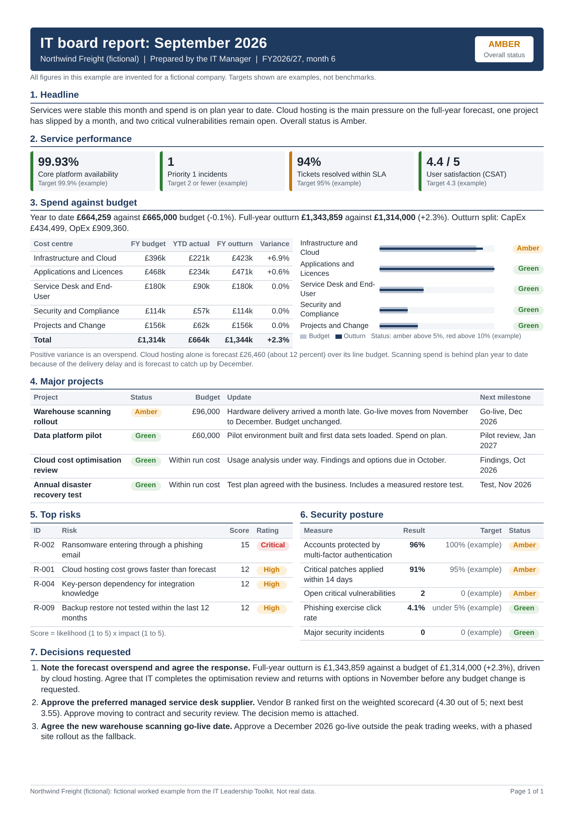
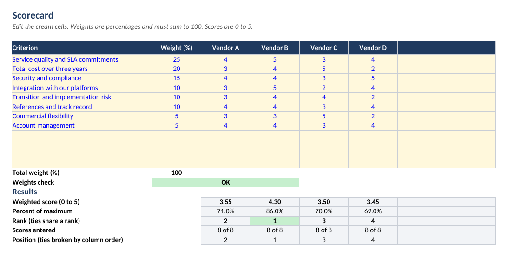
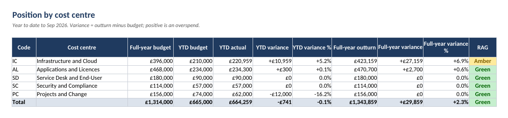

# IT Leadership Toolkit



[](https://github.com/pJijesh/it-leadership-toolkit/actions/workflows/ci.yml) [](LICENSE) 

**Problem:** IT leaders spend too much time rebuilding the same board reports, budget trackers, vendor comparisons and plans from a blank page.

**For:** IT managers and heads of IT in small and mid-sized organisations, and anyone reviewing how an IT function is run.

**Demonstrates:** board-level reporting, budget ownership, vendor management and ITIL-based service management, using templates with worked examples and checks that can be run.

All examples use one invented company, **Northwind Freight (fictional)**. No real organisation, person, contract or figure appears anywhere in this repository. Example targets are labelled "example" and are not benchmarks.



*The one-page board report example. [Download the PDF](docs/board-report-example.pdf).*

## What is in the toolkit

| # | Artefact | Purpose | Files | Preview |
|---|---|---|---|---|
| 1 | IT strategy and three-year roadmap | Link technology to business goals, with a now/next/later roadmap and investment summary | [template](01-it-strategy-and-roadmap/template.md), [example](01-it-strategy-and-roadmap/example-northwind.md) | |
| 2 | One-page board IT report | Give directors status, spend, risk, security and decisions in three minutes | [template](02-board-it-report/template.md), [example (md)](02-board-it-report/example-northwind-board-report.md), [example (html)](02-board-it-report/example-northwind-board-report.html), [PDF](docs/board-report-example.pdf) | [](docs/board-report-example.pdf) |
| 3 | KPI pack | 36 defined measures across service desk, availability, security, projects, cost and people | [guide](03-kpi-pack/README.md), [catalogue (md)](03-kpi-pack/kpi-catalogue.md), [catalogue (csv)](03-kpi-pack/kpi-catalogue.csv) | |
| 4 | Vendor scorecard | Weighted-criteria model with weights check, ranking, and a Python cross-check | [guide](04-vendor-scorecard/README.md), [workbook](04-vendor-scorecard/vendor-scorecard.xlsx), [csv](04-vendor-scorecard/vendor-scorecard-example.csv), [script](04-vendor-scorecard/score_vendors.py) | [](04-vendor-scorecard/README.md) |
| 5 | IT budget tracker | Budget, actual and forecast by cost centre, line and month, with CapEx and OpEx split | [guide](05-it-budget-tracker/README.md), [workbook](05-it-budget-tracker/it-budget-tracker.xlsx) | [](05-it-budget-tracker/README.md) |
| 6 | Monthly service review pack | ITIL-based review of incidents, problems, changes, SLAs, CSAT and improvement actions | [template](06-monthly-service-review/template.md), [example](06-monthly-service-review/example-northwind.md) | |
| 7 | Technology decision memo | Options, cost, risk and a clear recommendation on two pages | [template](07-technology-decision-memo/template.md), [example](07-technology-decision-memo/example-northwind.md) | |
| 8 | Risk register | Scored register with a 5 by 5 matrix and written guidance | [template](08-risk-register/risk-register-template.md), [template csv](08-risk-register/risk-register-template.csv), [example](08-risk-register/risk-register-example.md), [example csv](08-risk-register/risk-register-example.csv) | |
| 9 | New IT leader 30-60-90 day plan | Listen, plan, deliver: a first-quarter plan with outputs | [template](09-new-it-leader-30-60-90/template.md), [example](09-new-it-leader-30-60-90/example-northwind.md) | |
| 10 | Supplier contract renewal checklist | Work back from the notice date so contracts never renew by default | [template](10-supplier-contract-renewal/template.md), [example](10-supplier-contract-renewal/example-northwind.md) | |
| 11 | IT asset lifecycle plan | Plan refresh, security and secure disposal, with a budget profile | [template](11-it-asset-lifecycle/template.md), [example](11-it-asset-lifecycle/example-northwind.md) | |

The examples are connected, so the toolkit reads as one story. The budget tracker totals feed the board report. The vendor scorecard result feeds the decision memo, which feeds the contract renewal checklist. Risk IDs in the board report match the risk register. The service review figures match the board report.

## How to use it

1. **Pick the template you need** and read the "How to use this template" notes at the top. They explain the purpose and the common mistakes.
2. **Read the matching worked example** to see the level of detail expected.
3. **Copy the template into your own space** and replace the placeholders. Delete the guidance notes before sharing.
4. **For the workbooks**, open them in Excel or LibreOffice, change the cream-coloured input cells and leave the formulas alone. Each workbook has a Guide sheet.
5. **Adapt the targets.** Every target is an example. Set yours from contracts, history and your own risk appetite.

All text templates are plain Markdown, so they paste cleanly into Word, Confluence, SharePoint or a wiki.

## Checks and how the workbooks were verified

The repository includes automated checks in `tests/`:

- The vendor scoring script is tested for the weighted score, ranking (including ties), input validation and the command-line output.
- The workbooks are checked to contain formulas, then recalculated in LibreOffice (headless) and checked for error values. When LibreOffice is not installed these tests are skipped.
- The recalculated vendor scorecard is compared with the Python script, and the recalculated budget tracker is compared with an independent calculation from the example data.
- The CSV and workbook inputs are checked to be identical, the KPI and risk files are validated, and all text is checked for em-dashes and for broken relative links.

Run them with:

```bash
pip install -r requirements.txt
pytest
```

GitHub Actions runs the same checks on every push (`.github/workflows/ci.yml`).

## Rebuilding the generated files

The workbooks, CSVs, KPI markdown and the board report example are generated from `tools/example_data.py` and the `tools/build_*.py` scripts, so the examples stay consistent with each other.

```bash
pip install -r requirements-dev.txt
playwright install chromium
python tools/build_all.py
```

## Repository layout

```
01-it-strategy-and-roadmap/   template and example
02-board-it-report/           template, example (md and html)
03-kpi-pack/                  catalogue (csv and md) and guide
04-vendor-scorecard/          workbook, csv, Python script, guide
05-it-budget-tracker/         workbook and guide
06-monthly-service-review/    template and example
07-technology-decision-memo/  template and example
08-risk-register/             templates (md, csv) and examples
09-new-it-leader-30-60-90/    template and example
10-supplier-contract-renewal/ template and example
11-it-asset-lifecycle/        template and example
docs/                         board report PDF and screenshots
tools/                        build scripts and shared example data
tests/                        automated checks
```

## Roadmap

Planned, not promised. Order and timing change with other work.

- **Next:** Add capital business case template and ROI tracker; Add multi-year IT investment plan template
- **Then:** Add licence consolidation calculator; Add vendor risk scorecard
- **Later:** Refresh the board report example; Release v1.1

## About

Created by **Puliyappottammal Jijesh**, an IT Manager with more than 15 years of experience across service management (ITIL), project delivery (PRINCE2), vendor management and board reporting.

- GitHub: [pJijesh](https://github.com/pJijesh)
- LinkedIn: [linkedin.com/in/pjijesh](https://www.linkedin.com/in/pjijesh)

## Limitations

- Every company, figure, target and score is invented and labelled as an example. Replace them with your own before use.
- The workbooks were recalculated and checked in LibreOffice. They have not been opened in Excel.
- The generated files are not meant to be edited by hand. Change the scripts in `tools/` and run `build_all.py`.
- The templates are a starting point and do not replace your own governance, finance or legal review.

## Licence

[MIT](LICENSE). The templates are free to adapt and reuse. See [CONTRIBUTING.md](CONTRIBUTING.md) if you would like to suggest an improvement.
